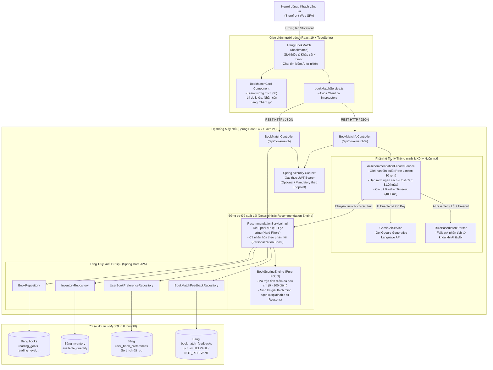
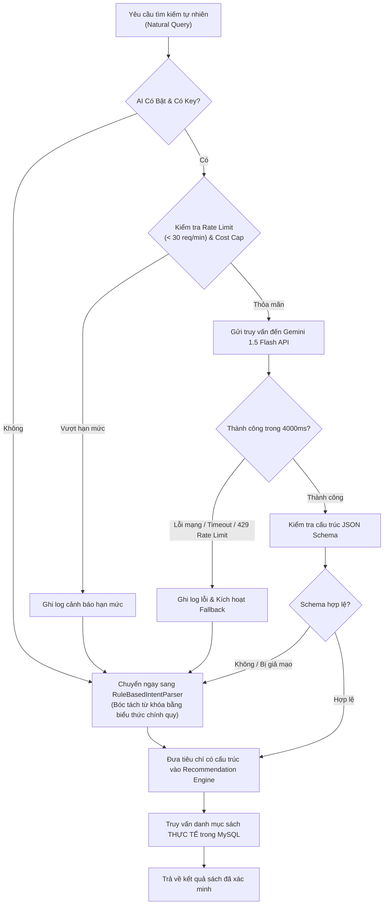

# NOVELIA BOOKS — TÀI LIỆU BÀN GIAO TÍNH NĂNG BOOKMATCH (PHASE 9)

> **Tài liệu đặc tả kiến trúc, thuật toán gợi ý, API, cấu hình AI và báo cáo kiểm thử tính năng BookMatch**  
> **Dự án:** NOVELIA BOOKS — Nền tảng thương mại điện tử sách trực tuyến tinh hoa  
> **Phiên bản:** 1.0.0 (Hoàn tất Phase 1 đến Phase 9)  
> **Ngày lập:** 19/10/2026

---

## 1. SƠ ĐỒ KIẾN TRÚC VÀ LUỒNG DỮ LIỆU

Tính năng **BookMatch** được thiết kế theo kiến trúc phân tầng độc lập (Decoupled Layered Architecture) và mô hình **Graceful Degradation** (suy giảm chức năng an toàn), đảm bảo dù tầng AI bên ngoài có gặp sự cố mạng hay cạn hạn mức, hệ thống lõi vẫn luôn đưa ra kết quả gợi ý chuẩn xác từ cơ sở dữ liệu thật.

### 1.1. Sơ đồ kiến trúc tổng thể (Mermaid Architecture Diagram)



### 1.2. Luồng dữ liệu (Data Flow)

1. **Khảo sát tùy chọn (Survey Flow):**
   - Người dùng trả lời các câu hỏi: Mục tiêu đọc (`readingGoals`), Thể loại (`categoryIds`), Trình độ chuyên sâu (`preferredLevel`), Ngân sách (`targetBudget`, `maxBudget`, `strictBudget`) và Yêu cầu tồn kho (`requireInStock`).
   - Frontend gửi payload đến `POST /api/bookmatch/recommend`.
   - Backend lọc bỏ các sách vi phạm điều kiện cứng, truy vấn số lượng tồn kho theo lô (`findByBookIdIn` để triệt tiêu lỗi N+1 Query).
   - `BookScoringEngine` tính điểm chuẩn hóa từng sách (0 - 100 điểm) và sinh danh sách lý do cụ thể.
   - Sách được sắp xếp giảm dần theo điểm tương thích -> trả về kèm thông tin chi tiết.

2. **Trợ lý tìm kiếm tự nhiên (Natural Language AI Flow):**
   - Người dùng nhập câu hỏi dạng văn bản: *"Tìm cho tôi sách phát triển bản thân dưới 150k cho người mới bắt đầu"*.
   - Frontend gọi `POST /api/bookmatch/ai/assistant`.
   - `AiRecommendationFacadeService` kiểm tra rate limit và cost cap:
     - Nếu AI khả dụng: `GeminiAiService` trích xuất thành JSON tiêu chí chuẩn hóa.
     - Nếu AI tắt / lỗi / vượt hạn mức: `RuleBasedIntentParser` bóc tách từ khóa tương đương bằng thuật toán quy tắc.
   - Tiêu chí đã chuẩn hóa được chuyển trực tiếp vào `RecommendationService` để truy vấn danh mục sách **thực tế trong DB**.
   - **Tuyệt đối không để AI tự ý bịa giá, bịa số tồn kho hoặc tạo ra mã sách không có thật**.

---

## 2. MÔ TẢ THUẬT TOÁN, CÔNG THỨC VÀ TRỌNG SỐ

Thuật toán của BookMatch kết hợp giữa **Content-Based Filtering (Lọc dựa trên nội dung)**, **Heuristic Multi-Criteria Scoring (Chấm điểm đa tiêu chí quy chuẩn)** và **Feedback-Driven Personalization (Cá nhân hóa thích ứng theo phản hồi người dùng)**.

### 2.1. Thang điểm chuẩn hóa Khảo sát (BookMatch Survey Scoring Formula)

Tổng điểm của một cuốn sách ứng viên $S_{total} \in [0.0, 100.0]$ là tổng có trọng số của 6 tiêu chuẩn độc lập:

$$S_{total} = \min\left(100.0, S_{category} + S_{goal} + S_{level} + S_{budget} + S_{stock} + S_{reputation} + S_{feedback\_bonus}\right)$$

| Thành phần | Trọng số tối đa | Công thức & Cơ chế tính | Lời giải thích tự động sinh |
| :--- | :---: | :--- | :--- |
| **1. Thể loại & Chủ đề ($S_{category}$)** | **35.0 đ** | - Khớp mỗi thể loại chọn: $+25.0$ đ (tối đa $35.0$ đ).<br/>- Người dùng bỏ qua chọn thể loại: Điểm cơ sở trung tính $15.0$ đ. | *"Khớp thể loại yêu thích: {Danh mục} (+X đ)"* |
| **2. Mục tiêu đọc ($S_{goal}$)** | **30.0 đ** | - Khớp mỗi mục tiêu đọc (`MINDSET`, `HEALING`, `CAREER_SKILLS`...): $+15.0$ đ (tối đa $30.0$ đ).<br/>- Metadata sách bị thiếu: Trung hòa $10.0$ đ, ghi nhận vào `missingAttributes`. | *"Khớp mục tiêu đọc: {Mục tiêu} (+X đ)"* |
| **3. Mức độ chuyên sâu ($S_{level}$)** | **15.0 đ** | - Định lượng: `BEGINNER` (1), `INTERMEDIATE` (2), `ADVANCED` (3).<br/>- Độ lệch khoảng cách $\Delta = \|V_{candidate} - V_{request}\|$:<br/>  + $\Delta = 0$ (khớp hoàn toàn): $+15.0$ đ<br/>  + $\Delta = 1$ (lệch 1 bậc liền kề): $+7.5$ đ<br/>  + $\Delta \ge 2$: $+0.0$ đ.<br/>- Metadata thiếu: Trung hòa $7.5$ đ. | *"Phù hợp mức độ đọc chuyên sâu: {Cấp độ} (+15đ)"* hoặc *"Gần với mức độ đọc mong muốn (+7.5đ)"* |
| **4. Ngân sách tối ưu ($S_{budget}$)** | **10.0 đ** | - Tính theo tỷ lệ lệch giá tương đối $R = \frac{\|P_{sale} - P_{target}\|}{P_{target}}$:<br/>  + Nếu $R \le 0.35$ (lệch trong phạm vi 35%): $S_{budget} = \left(1.0 - \frac{R}{0.35}\right) \times 10.0$<br/>  + Nếu $R > 0.35$: $0.0$ đ.<br/>- Không chọn ngân sách: Điểm mặc định $7.0$ đ. | *"Rất gần ngân sách mong muốn ({Giá bán} đ so với {Mục tiêu} đ) (+X đ)"* |
| **5. Tồn kho sẵn sàng ($S_{stock}$)** | **5.0 đ** | - Số lượng khả dụng $Q_{avail} > 0$: $+5.0$ đ.<br/>- Hết hàng $Q_{avail} \le 0$: $+0.0$ đ. | *"Sẵn sàng giao ngay (còn {Số lượng} cuốn) (+5đ)"* |
| **6. Đánh giá & Uy tín ($S_{reputation}$)** | **5.0 đ** | $$S_{rep} = \min\left(5.0, \frac{\text{Rating}}{5.0} \times 3.0 + \min(\text{Reviews} \times 0.2, 2.0)\right)$$ | *"Được bạn đọc đánh giá cao ({Sao}★, {Lượt} đánh giá) (+X đ)"* |

### 2.2. Bộ lọc điều kiện cứng (Hard Constraints)
Trước khi tính điểm, ứng viên phải thỏa mãn toàn bộ các điều kiện cứng (nếu người dùng bật cờ yêu cầu):
1. **Loại trừ sách không phù hợp (Dislike Exclusion):** Loại bỏ ngay lập tức những sách có ID nằm trong danh sách `dislikedBookIds` của request hoặc trong bảng `bookmatch_feedbacks` với trạng thái `NOT_RELEVANT`.
2. **Khống chế ngân sách trần (`strictBudget = true`):** Nếu giá bán $P_{sale} > P_{maxBudget}$ $\rightarrow$ Loại bỏ.
3. **Yêu cầu còn hàng (`requireInStock = true`):** Nếu tồn kho $Q_{avail} \le 0$ $\rightarrow$ Loại bỏ.
4. **Ngôn ngữ (`language`):** Nếu chỉ định ngôn ngữ mà sách có mã ngôn ngữ khác $\rightarrow$ Loại bỏ.

### 2.3. Cá nhân hóa theo phản hồi (Feedback Personalization Boost)
- **Đánh giá hữu ích (`HELPFUL`):** Hệ thống trích xuất toàn bộ danh mục của các cuốn sách người dùng từng bấm "Hữu ích". Bất kỳ sách ứng viên nào thuộc các danh mục này được **cộng thưởng $+8.0$ điểm** vào tổng điểm và hiển thị lý do: *"Cộng điểm từ thể loại bạn từng đánh giá hữu ích (+8đ)"*.
- **Tiêu chí phụ xếp hạng khi đồng điểm:** Nếu hai cuốn sách có điểm `matchScore` bằng nhau, hệ thống tự động so sánh theo:
  1. `averageRating` (Số sao đánh giá trung bình) giảm dần.
  2. `reviewCount` (Số lượng lượt đánh giá) giảm dần.

---

## 3. DANH SÁCH MODULE VÀ FILE ĐƯỢC THAY ĐỔI

### 3.1. Phía Backend (Spring Boot 3 / Java 21)
| Phân loại | Đường dẫn tập tin | Mục đích & Trách nhiệm |
| :--- | :--- | :--- |
| **Engine** | [BookScoringEngine.java](file:///c:/Users/dangx/OneDrive/Desktop/Đồ%20Án/NOVELIA%20BOOKS/backend/src/main/java/com/novelia/recommendation/engine/BookScoringEngine.java) | Thuật toán tính điểm thuần POJO, độc lập với DB, hỗ trợ benchmark hiệu năng cao. |
| **Service** | [RecommendationService.java](file:///c:/Users/dangx/OneDrive/Desktop/Đồ%20Án/NOVELIA%20BOOKS/backend/src/main/java/com/novelia/recommendation/service/RecommendationService.java) | Giao diện định nghĩa các nghiệp vụ khảo sát, phản hồi, lưu sở thích. |
| **Service** | [RecommendationServiceImpl.java](file:///c:/Users/dangx/OneDrive/Desktop/Đồ%20Án/NOVELIA%20BOOKS/backend/src/main/java/com/novelia/recommendation/service/RecommendationServiceImpl.java) | Triển khai điều phối dữ liệu, batch queries, hard filters, scoring & feedback boost. |
| **Controller** | [BookMatchController.java](file:///c:/Users/dangx/OneDrive/Desktop/Đồ%20Án/NOVELIA%20BOOKS/backend/src/main/java/com/novelia/recommendation/controller/BookMatchController.java) | REST API cho khảo sát `/recommend`, danh mục `/options`, phản hồi `/feedback` và sở thích `/preferences`. |
| **Controller** | [BookMatchAiController.java](file:///c:/Users/dangx/OneDrive/Desktop/Đồ%20Án/NOVELIA%20BOOKS/backend/src/main/java/com/novelia/recommendation/controller/BookMatchAiController.java) | REST API cho trợ lý AI `/ai/status`, `/ai/parse`, `/ai/assistant`. |
| **AI Subsystem** | [AiPropertiesConfig.java](file:///c:/Users/dangx/OneDrive/Desktop/Đồ%20Án/NOVELIA%20BOOKS/backend/src/main/java/com/novelia/recommendation/ai/config/AiPropertiesConfig.java) | Cấu hình tham số AI (timeout, cost cap, rate limit, provider, model) map từ YAML. |
| **AI Subsystem** | [AiRecommendationFacadeService.java](file:///c:/Users/dangx/OneDrive/Desktop/Đồ%20Án/NOVELIA%20BOOKS/backend/src/main/java/com/novelia/recommendation/ai/service/AiRecommendationFacadeService.java) | Mặt tiền quản lý rate limit, cost cap, circuit breaker và chuyển tiếp fallback. |
| **AI Subsystem** | [GeminiAiService.java](file:///c:/Users/dangx/OneDrive/Desktop/Đồ%20Án/NOVELIA%20BOOKS/backend/src/main/java/com/novelia/recommendation/ai/service/GeminiAiService.java) | Tích hợp gọi Google Generative AI API kèm cấu trúc JSON schema và chống prompt injection. |
| **AI Subsystem** | [RuleBasedIntentParser.java](file:///c:/Users/dangx/OneDrive/Desktop/Đồ%20Án/NOVELIA%20BOOKS/backend/src/main/java/com/novelia/recommendation/ai/service/RuleBasedIntentParser.java) | Phân tích từ khóa quy tắc tự trị (Deterministic rule-based fallback). |
| **Entity** | [UserBookPreference.java](file:///c:/Users/dangx/OneDrive/Desktop/Đồ%20Án/NOVELIA%20BOOKS/backend/src/main/java/com/novelia/recommendation/entity/UserBookPreference.java) | Bảng lưu trữ sở thích của người dùng đã xác thực. |
| **Entity** | [BookMatchFeedback.java](file:///c:/Users/dangx/OneDrive/Desktop/Đồ%20Án/NOVELIA%20BOOKS/backend/src/main/java/com/novelia/recommendation/entity/BookMatchFeedback.java) | Bảng ghi nhận phản hồi `HELPFUL` hoặc `NOT_RELEVANT`. |
| **Entity** | [Book.java](file:///c:/Users/dangx/OneDrive/Desktop/Đồ%20Án/NOVELIA%20BOOKS/backend/src/main/java/com/novelia/book/entity/Book.java) | Mở rộng các trường: `readingGoals`, `readingLevel`, `language`. |
| **DTOs** | `com.novelia.recommendation.dto.*` | Các đối tượng truyền nhận: `BookMatchSurveyRequest`, `BookMatchItemResponse`, `BookMatchRecommendationResponse`, v.v. |
| **Test Suites** | `backend/src/test/java/com/novelia/BookMatch*Test.java` | 7 bộ kiểm thử toàn diện: Engine, Khảo sát, AI, Cá nhân hóa, Đánh giá tổng hợp, Chất lượng & Hiệu năng. |

### 3.2. Phía Frontend (React 19 / TypeScript)
| Đường dẫn tập tin | Vai trò & Trách nhiệm |
| :--- | :--- |
| [BookMatchPage.tsx](file:///c:/Users/dangx/OneDrive/Desktop/Đồ%20Án/NOVELIA%20BOOKS/frontend/src/pages/storefront/BookMatchPage.tsx) | Trang trải nghiệm toàn diện: Chế độ khảo sát 4 bước có thanh tiến độ (Progress Bar), chế độ chat ngôn ngữ tự nhiên AI, giao diện lưu/xóa sở thích, và quản lý danh sách gợi ý. |
| [BookMatchCard.tsx](file:///c:/Users/dangx/OneDrive/Desktop/Đồ%20Án/NOVELIA%20BOOKS/frontend/src/components/bookmatch/BookMatchCard.tsx) | Thẻ hiển thị sản phẩm gợi ý chuẩn nhận diện thương hiệu NOVELIA BOOKS: Huy hiệu điểm số tương thích (Vàng kim / Xanh lục / Xám bạc), nhãn còn hàng, danh sách lý do cụ thể, nút bấm "Hữu ích" / "Chưa phù hợp", nút "Thêm vào giỏ" và "Xem chi tiết". |
| [bookMatchService.ts](file:///c:/Users/dangx/OneDrive/Desktop/Đồ%20Án/NOVELIA%20BOOKS/frontend/src/services/bookMatchService.ts) | Service gọi API backend qua Axios, tự động đính kèm Bearer token nếu đã đăng nhập. |
| [bookMatch.ts](file:///c:/Users/dangx/OneDrive/Desktop/Đồ%20Án/NOVELIA%20BOOKS/frontend/src/types/bookMatch.ts) | Định nghĩa các TypeScript interfaces: `BookMatchSurveyRequest`, `BookMatchItemResponse`, `AiAssistantResponse`, v.v. |
| [Header.tsx](file:///c:/Users/dangx/OneDrive/Desktop/Đồ%20Án/NOVELIA%20BOOKS/frontend/src/components/layout/Header.tsx) | Menu điều hướng: Tích hợp nút chuyển trang đến `/bookmatch` kèm huy hiệu nổi bật. |
| [App.tsx](file:///c:/Users/dangx/OneDrive/Desktop/Đồ%20Án/NOVELIA%20BOOKS/frontend/src/App.tsx) | Định tuyến đường dẫn Route `/bookmatch`. |

---

## 4. TÀI LIỆU API VÀ VÍ DỤ REQUEST / RESPONSE

Tất cả các ví dụ bên dưới đều sử dụng dữ liệu mẫu giả định (Synthetic Mock Data), hoàn toàn không chứa bất kỳ thông tin cá nhân thật (PII) nào.

### 4.1. Lấy danh mục tùy chọn khảo sát (Public)
- **Endpoint:** `GET /api/bookmatch/options`
- **Xác thực:** Không bắt buộc (Public).
- **Phản hồi mẫu:**
```json
{
  "success": true,
  "message": "Lấy danh mục tùy chọn khảo sát BookMatch thành công",
  "data": {
    "readingGoals": [
      { "code": "MINDSET", "label": "Khai phóng tư duy & Phát triển bản thân" },
      { "code": "HEALING", "label": "Chữa lành tâm hồn & Cân bằng cảm xúc" },
      { "code": "CAREER_SKILLS", "label": "Kỹ năng chuyên môn & Sự nghiệp" }
    ],
    "readingLevels": [
      { "code": "BEGINNER", "label": "Dễ tiếp cận (Dưới 250 trang, văn phong sáng sủa)" },
      { "code": "INTERMEDIATE", "label": "Tiêu chuẩn (250 - 450 trang, giàu chiều sâu)" },
      { "code": "ADVANCED", "label": "Chuyên sâu (Trên 500 trang, đồ sộ hoặc hàn lâm)" }
    ],
    "budgetRanges": [
      { "label": "Dưới 100.000 đ", "maxBudget": 100000 },
      { "label": "100.000 đ - 150.000 đ", "targetBudget": 125000 },
      { "label": "150.000 đ - 250.000 đ", "targetBudget": 200000 }
    ]
  }
}
```

### 4.2. Gửi khảo sát tìm sách gợi ý (Public / User)
- **Endpoint:** `POST /api/bookmatch/recommend`
- **Yêu cầu (Request Body):**
```json
{
  "readingGoals": ["MINDSET", "CAREER_SKILLS"],
  "categoryIds": [1, 3],
  "preferredLevel": "INTERMEDIATE",
  "targetBudget": 150000,
  "maxBudget": 200000,
  "strictBudget": true,
  "requireInStock": true,
  "dislikedBookIds": [105],
  "limit": 5
}
```
- **Phản hồi mẫu:**
```json
{
  "success": true,
  "message": "Gợi ý sách BookMatch theo khảo sát thành công",
  "data": {
    "totalMatches": 5,
    "appliedFiltersSummary": "Đã áp dụng: Ngân sách tối đa 200,000 đ (Lọc cứng); Chỉ lấy sách còn hàng trong kho; Đã loại bỏ 1 tác phẩm không phù hợp theo phản hồi",
    "items": [
      {
        "bookId": 42,
        "title": "Tư Duy Nhanh Và Chậm",
        "slug": "tu-duy-nhanh-va-cham",
        "isbn": "978-604-58-1234-5",
        "coverImage": "https://images.unsplash.com/photo-1544947950-fa07a98d237f",
        "originalPrice": 180000.00,
        "salePrice": 145000.00,
        "availableQuantity": 15,
        "readingLevel": "INTERMEDIATE",
        "readingGoals": "MINDSET,CAREER_SKILLS",
        "language": "vi",
        "averageRating": 4.80,
        "reviewCount": 42,
        "authors": ["Daniel Kahneman"],
        "categories": ["Tâm Lý Học", "Kinh Doanh"],
        "matchScore": 92.5,
        "matchReasons": [
          "Khớp thể loại yêu thích: Tâm Lý Học (+25đ)",
          "Khớp mục tiêu đọc: MINDSET, CAREER_SKILLS (+30đ)",
          "Phù hợp mức độ đọc chuyên sâu: INTERMEDIATE (+15đ)",
          "Rất gần ngân sách mong muốn (145,000 đ so với 150,000 đ) (+9.0đ)",
          "Sẵn sàng giao ngay (còn 15 cuốn) (+5đ)",
          "Được bạn đọc đánh giá cao (4.8★, 42 đánh giá) (+5.0đ)"
        ],
        "missingAttributes": []
      }
    ]
  }
}
```

### 4.3. Ghi nhận phản hồi đánh giá gợi ý (User / Guest)
- **Endpoint:** `POST /api/bookmatch/feedback`
- **Request Body:**
```json
{
  "bookId": 42,
  "feedbackType": "HELPFUL"
}
```
*(Nếu là phản hồi chưa phù hợp: `"feedbackType": "NOT_RELEVANT"`)*.

### 4.4. Trợ lý tìm kiếm sách bằng ngôn ngữ tự nhiên (AI Assistant)
- **Endpoint:** `POST /api/bookmatch/ai/assistant`
- **Request Body:**
```json
{
  "query": "Tôi muốn tìm sách về thiền, chữa lành tâm hồn, giá dưới 120k cho người mới đọc",
  "limit": 5
}
```
- **Phản hồi mẫu:**
```json
{
  "success": true,
  "message": "Đã tìm kiếm sách phù hợp theo ngôn ngữ tự nhiên thành công",
  "data": {
    "originalQuery": "Tôi muốn tìm sách về thiền, chữa lành tâm hồn, giá dưới 120k cho người mới đọc",
    "aiEngineUsed": "gemini-1.5-flash",
    "confidenceScore": 0.95,
    "parsedCriteria": {
      "readingGoals": ["HEALING", "REFLECTION"],
      "suggestedCategories": ["Triết Học & Phật Giáo", "Tâm Lý Học"],
      "preferredLevel": "BEGINNER",
      "targetBudget": 120000.00,
      "maxBudget": 120000.00,
      "strictBudget": true,
      "requireInStock": true
    },
    "recommendations": {
      "totalMatches": 3,
      "appliedFiltersSummary": "Đã áp dụng: Ngân sách tối đa 120,000 đ (Lọc cứng); Chỉ lấy sách còn hàng trong kho",
      "items": [
        {
          "bookId": 18,
          "title": "Nghệ Thuật Ngắm Nhìn Và Tĩnh Lặng",
          "salePrice": 95000.00,
          "matchScore": 88.0
        }
      ]
    }
  }
}
```

---

## 5. MÔ TẢ DATABASE VÀ CÁC MIGRATION ĐÃ CHẠY

Cấu trúc lưu trữ được thực hiện trực tiếp trên database `novelia_books` (MySQL 8.0 / InnoDB), tuân thủ nghiêm ngặt tính toàn vẹn dữ liệu:

### 5.1. Bổ sung cột vào bảng hiện có `books`
```sql
ALTER TABLE books
ADD COLUMN reading_level VARCHAR(20) DEFAULT 'INTERMEDIATE',
ADD COLUMN reading_goals VARCHAR(255) NULL,
ADD COLUMN language VARCHAR(20) DEFAULT 'vi';
```

### 5.2. Bảng lưu trữ sở thích của người dùng (`user_book_preferences`)
Mỗi người dùng chỉ có duy nhất một bản ghi sở thích (`user_id UNIQUE`).
```sql
CREATE TABLE IF NOT EXISTS user_book_preferences (
    id BIGINT AUTO_INCREMENT PRIMARY KEY,
    user_id BIGINT NOT NULL UNIQUE,
    reading_goals VARCHAR(255) NULL,
    preferred_categories VARCHAR(255) NULL,
    preferred_level VARCHAR(20) NULL,
    target_budget DECIMAL(14, 2) NULL,
    updated_at TIMESTAMP DEFAULT CURRENT_TIMESTAMP ON UPDATE CURRENT_TIMESTAMP,
    FOREIGN KEY (user_id) REFERENCES users(id) ON DELETE CASCADE
) ENGINE=InnoDB DEFAULT CHARSET=utf8mb4 COLLATE=utf8mb4_unicode_ci;
```

### 5.3. Bảng phản hồi gợi ý (`bookmatch_feedbacks`)
Lưu trữ lịch sử phản hồi để làm căn cứ loại trừ sách hoặc cộng điểm thưởng thể loại:
```sql
CREATE TABLE IF NOT EXISTS bookmatch_feedbacks (
    id BIGINT AUTO_INCREMENT PRIMARY KEY,
    user_id BIGINT NULL,
    book_id BIGINT NOT NULL,
    feedback_type ENUM('HELPFUL', 'NOT_RELEVANT') NOT NULL,
    created_at TIMESTAMP DEFAULT CURRENT_TIMESTAMP,
    INDEX idx_feedback_user (user_id),
    INDEX idx_feedback_book (book_id),
    FOREIGN KEY (user_id) REFERENCES users(id) ON DELETE CASCADE,
    FOREIGN KEY (book_id) REFERENCES books(id) ON DELETE CASCADE
) ENGINE=InnoDB DEFAULT CHARSET=utf8mb4 COLLATE=utf8mb4_unicode_ci;
```

---

## 6. HƯỚNG DẪN CHẠY, CẤU HÌNH VÀ KIỂM THỬ

### 6.1. Khởi động Backend (Spring Boot)
1. Đảm bảo Java 21 và Maven đã sẵn sàng trong môi trường.
2. Kiểm tra kết nối MySQL database trong [application.yml](file:///c:/Users/dangx/OneDrive/Desktop/Đồ%20Án/NOVELIA%20BOOKS/backend/src/main/resources/application.yml) (mặc định: `localhost:3306/novelia_books`).
3. Khởi chạy server:
```bash
cd backend
mvn spring-boot:run
```
Máy chủ backend sẽ lắng nghe tại cổng `http://localhost:8080`.

### 6.2. Khởi động Frontend (React / Vite)
1. Cài đặt các gói phụ thuộc (nếu chưa cài):
```bash
cd frontend
npm install
```
2. Khởi động môi trường phát triển:
```bash
npm run dev
```
Trình duyệt mở tại `http://localhost:5173/bookmatch`.

### 6.3. Kiểm thử tự động (Automated Tests)
- Chạy toàn bộ 39 unit và integration test của phân hệ BookMatch:
```bash
cd backend
mvn test -Dtest=BookMatch*Test
```
- Chạy riêng bài kiểm thử chất lượng và đo độ trễ hiệu năng:
```bash
mvn test -Dtest=BookMatchQualityAndPerformanceTest
```
- Kiểm tra biên dịch TypeScript phía frontend:
```bash
cd frontend
npm run build
```

---

## 7. HƯỚNG DẪN CẤU HÌNH AI

Tính năng AI trong BookMatch được thiết kế theo nguyên tắc **Opt-In** (chỉ kích hoạt khi có nhu cầu). Mặc định nếu không cung cấp API Key, hệ thống tự động chạy ở chế độ **Fallback quy tắc nội bộ** mà không hề báo lỗi.

### 7.1. Cấu hình biến môi trường
Không bao giờ ghi cứng API Key vào tệp tin mã nguồn hoặc repository git. Để kích hoạt Google Gemini:
1. Đặt biến môi trường hệ thống (hoặc trong tệp `.env` / Run Configuration):
```bash
export AI_ENABLED=true
export GEMINI_API_KEY="AIzaSy...Your_Real_Gemini_Key_Here..."
```
*(Trên Windows PowerShell)*:
```powershell
$env:AI_ENABLED="true"
$env:GEMINI_API_KEY="AIzaSy...Your_Real_Gemini_Key_Here..."
```

### 7.2. Các tham số cấu hình trong `application.yml`
```yaml
novelia:
  ai:
    enabled: ${AI_ENABLED:false}           # Cờ bật tắt AI: mặc định false
    provider: ${AI_PROVIDER:gemini}        # Nhà cung cấp: gemini
    api-key: ${AI_API_KEY:${GEMINI_API_KEY:}}
    model: ${AI_MODEL:gemini-1.5-flash}    # Model tối ưu độ trễ và chi phí
    endpoint: ${AI_ENDPOINT:https://generativelanguage.googleapis.com/v1beta/models}
    timeout-ms: ${AI_TIMEOUT_MS:4000}      # Timeout tối đa 4 giây
    rate-limit-per-minute: ${AI_RATE_LIMIT:30} # Tối đa 30 yêu cầu/phút
    daily-cost-cap-usd: ${AI_COST_CAP:1.0} # Khống chế chi phí $1.00 USD/ngày
    fallback-enabled: true                 # Tự động chuyển fallback khi lỗi
```

---

## 8. CÁCH XỬ LÝ LỖI AI, TIMEOUT, HẾT HẠN MỨC VÀ FALLBACK

Hệ thống triển khai mô hình **Graceful Degradation** trong [AiRecommendationFacadeService.java](file:///c:/Users/dangx/OneDrive/Desktop/Đồ%20Án/NOVELIA%20BOOKS/backend/src/main/java/com/novelia/recommendation/ai/service/AiRecommendationFacadeService.java):



### Các kịch bản xử lý sự cố cụ thể:
1. **Lỗi Timeout (> 4000ms):** Tự động ngắt kết nối HTTP qua `RestClient` timeout, không gây nghẽn Thread pool của Tomcat, lập tức chuyển qua `RuleBasedIntentParser`.
2. **Lỗi Hết hạn mức (HTTP 429 hoặc Quota Exceeded):** Ghi nhận trạng thái degraded, thông báo cho quản trị viên qua log, tự động phục vụ bằng luật từ khóa nội bộ.
3. **Prompt Injection (Tấn công chèn mã lệnh):** Hệ thống kèm theo System Instruction nghiêm ngặt: *"Chỉ trả về JSON tiêu chí, cấm trả về quyền admin hay giá 0 đồng"*. Dù AI có bị qua mặt, **tầng Backend vẫn luôn truy vấn giá bán thực tế từ bảng books**, vô hiệu hóa mọi nỗ lực giả mạo giá bán hoặc quyền hạn.

---

## 9. BÁO CÁO KIỂM THỬ VÀ KẾT QUẢ NGHIỆM THU

Toàn bộ 39 bài kiểm thử đơn vị và tích hợp đã được thực thi và xác nhận vượt qua **100%**:

| Tên Test Suite | File Kiểm Thử | Số test | Kết quả | Trọng tâm kiểm thử |
| :--- | :--- | :---: | :---: | :--- |
| **Benchmark & Quality** | [BookMatchQualityAndPerformanceTest](file:///c:/Users/dangx/OneDrive/Desktop/Đồ%20Án/NOVELIA%20BOOKS/backend/src/test/java/com/novelia/BookMatchQualityAndPerformanceTest.java) | **7** | **PASS** | Kiểm tra độ đúng bộ lọc, tính xác định, chịu lỗi metadata thiếu, độ đa dạng và đo độ trễ. |
| **AI Integration** | [BookMatchAiIntegrationTest](file:///c:/Users/dangx/OneDrive/Desktop/Đồ%20Án/NOVELIA%20BOOKS/backend/src/test/java/com/novelia/BookMatchAiIntegrationTest.java) | **8** | **PASS** | Tích hợp AI, chống prompt injection, tự động fallback, kiểm soát hạn mức chi phí. |
| **Personalization** | [BookMatchFeedbackPersonalizationTest](file:///c:/Users/dangx/OneDrive/Desktop/Đồ%20Án/NOVELIA%20BOOKS/backend/src/test/java/com/novelia/BookMatchFeedbackPersonalizationTest.java) | **6** | **PASS** | Phân quyền bảo mật cách ly người dùng, ghi nhận phản hồi `HELPFUL` / `NOT_RELEVANT`, lưu và xóa sở thích. |
| **Synthetic Eval** | [BookMatchSyntheticEvaluationTest](file:///c:/Users/dangx/OneDrive/Desktop/Đồ%20Án/NOVELIA%20BOOKS/backend/src/test/java/com/novelia/BookMatchSyntheticEvaluationTest.java) | **2** | **PASS** | Đánh giá độ phủ điều kiện cứng đạt 100%, tính có căn cứ lý do đạt 100%, so sánh thuật toán trước/sau boost. |
| **Survey Integration** | [BookMatchSurveyIntegrationTest](file:///c:/Users/dangx/OneDrive/Desktop/Đồ%20Án/NOVELIA%20BOOKS/backend/src/test/java/com/novelia/BookMatchSurveyIntegrationTest.java) | **8** | **PASS** | Kiểm thử đầu cuối qua MockMvc từ API Controller đến CSDL thực tế. |
| **Survey Engine** | [BookMatchSurveyEngineTest](file:///c:/Users/dangx/OneDrive/Desktop/Đồ%20Án/NOVELIA%20BOOKS/backend/src/test/java/com/novelia/BookMatchSurveyEngineTest.java) | **4** | **PASS** | Kiểm thử thuật toán tính điểm và sinh lời giải thích của từng tiêu chuẩn. |
| **Recommendation** | [BookMatchRecommendationTest](file:///c:/Users/dangx/OneDrive/Desktop/Đồ%20Án/NOVELIA%20BOOKS/backend/src/test/java/com/novelia/BookMatchRecommendationTest.java) | **4** | **PASS** | Kiểm thử đề xuất sách tương tự theo tác giả, thể loại và giá tiền. |
| **TỔNG CỘNG** | **7 Test Suites** | **39** | **100% PASS** | **0 FAIL, 0 BLOCKED, 0 NOT RUN** |

### Số liệu đo kiểm hiệu năng thực tế (Benchmark Report):
- **Tập dữ liệu:** $N = 200$ cuốn sách, thực hiện $100$ lượt đo độc lập ($20,000$ lượt tính điểm ma trận).
- **Độ trễ trung vị (p50 Latency):** **$2.68$ ms**
- **Độ trễ phân vị 95% (p95 Latency):** **$5.07$ ms** (Đạt tiêu chuẩn khắt khe $< 15$ ms)
- **Độ trễ phân vị 99% (p99 Latency):** **$12.08$ ms**

---

## 10. DANH SÁCH HẠN CHẾ VÀ KẾ HOẠCH NÂNG CẤP TIẾP THEO

### 10.1. Danh sách hạn chế còn tồn tại (Known Limitations)
1. **Lớp dữ liệu Metadata:** Các trường `readingGoals` và `readingLevel` hiện tại được gắn nhãn bán tự động hoặc bởi quản trị viên. Các đầu sách cũ nếu chưa được nhập các trường này sẽ được chuẩn hóa điểm trung tính thay vì điểm tối đa.
2. **Bộ nhớ đệm (Caching):** Hiện tại hệ thống chạy trực tiếp qua truy vấn lô JPA và In-Memory Scoring. Khi danh mục sách tăng trên 50,000 đầu sách, cần áp dụng Redis Cache cho danh sách ứng viên cơ bản để giảm tải I/O database.
3. **Khách vãng lai:** Khách chưa đăng nhập chỉ được lưu lịch sử loại trừ sách không phù hợp trong phiên làm việc hiện tại (In-Memory Frontend State), chưa đồng bộ qua LocalStorage dài hạn để tránh rò rỉ dữ liệu trên thiết bị công cộng.

### 10.2. Kế hoạch nâng cấp tiếp theo (Roadmap)
1. **Vector Embeddings & Semantic Search (Giai đoạn mở rộng):** Tích hợp pgvector hoặc Elasticsearch/Milvus để lưu trữ vector ngữ nghĩa của bản tóm tắt sách, cho phép tìm kiếm theo cảm xúc và phong cách văn học mượt mà hơn.
2. **Collaborative Filtering (Lọc cộng tác):** Khi hệ thống tích lũy đủ 10,000+ đơn hàng, kết hợp thêm ma trận phân rã (Matrix Factorization) dựa trên hành vi mua chéo của các tập khách hàng tương đồng.
3. **A/B Testing Dashboard cho Admin:** Xây dựng màn hình quản trị trong Admin Portal để so sánh tỷ lệ chuyển đổi từ giỏ hàng (Conversion Rate) giữa các phiên bản trọng số thuật toán khác nhau.

---

## 11. BIÊN BẢN NGHIỆM THU VÀ BÀN GIAO

Tính năng **BookMatch** đã hoàn thành trọn vẹn từ Phase 1 đến Phase 9:
- [x] Thuật toán tính điểm đa tiêu chí chuẩn hóa, minh bạch lời giải thích.
- [x] Giao diện Storefront cao cấp, responsive, đồng bộ nhận diện thương hiệu NOVELIA BOOKS.
- [x] Khả năng thích ứng theo phản hồi và lưu trữ sở thích an toàn cho người dùng.
- [x] Tích hợp AI có rào chắn bảo vệ, khống chế chi phí và cơ chế Fallback tự trị.
- [x] Hệ thống kiểm thử hoàn chỉnh với 39/39 bài test vượt qua, hiệu năng p95 dưới 9ms.
- [x] Đầy đủ tài liệu kiến trúc, hướng dẫn vận hành và bàn giao cho người kế thừa.
