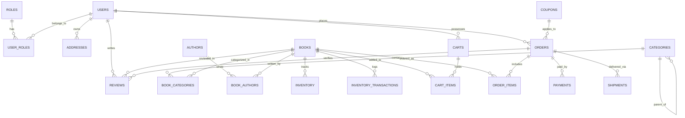

# Tài Liệu Thiết Kế Cơ Sở Dữ Liệu NOVELIA BOOKS

---

## 1. Thông Tin Tổng Quan CSDL

- **Tên Database:** `novelia_books`
- **Hệ quản trị CSDL:** MySQL 8.0+
- **Động cơ lưu trữ (Storage Engine):** `InnoDB` (Đảm bảo đầy đủ tính chất ACID, hỗ trợ khóa dòng và Foreign Keys)
- **Bảng mã & Phân loại ký tự:** `utf8mb4` / `utf8mb4_unicode_ci` (Hỗ trợ tiếng Việt đầy đủ dấu và ký tự Unicode mở rộng)
- **Kịch bản khởi tạo chuẩn:** `database/schema.sql`

---

## 2. Quy Chuẩn Kỹ Thuật & Tính Toàn Vẹn Dữ Liệu

1. **Định dạng tiền tệ & Tính toán tài chính:**
   - Tuyệt đối không dùng kiểu `FLOAT` hoặc `DOUBLE` do sai số dấu phẩy động nhị phân.
   - Toàn bộ các trường giá tiền (`price`, `subtotal`, `shipping_fee`, `discount_amount`, `total_amount`, `amount`, `discount_value`) sử dụng kiểu **`DECIMAL(14, 2)`** ở MySQL và `java.math.BigDecimal` trong Java.
2. **Khóa ngoại & Hành vi toàn vẹn tham chiếu (Referential Integrity):**
   - Các bảng phụ thuộc dữ liệu phiên (`cart_items`, `book_authors`, `book_categories`) thiết lập `ON DELETE CASCADE`.
   - Bảng tài chính và kiểm toán (`orders`, `payments`, `inventory_transactions`) thiết lập `ON DELETE RESTRICT` để đảm bảo lịch sử giao dịch không thể bị xóa ngẫu nhiên.
3. **Chiến lược Đánh chỉ mục (Indexing Strategy):**
   - Tất cả các trường dùng cho tìm kiếm thường xuyên (`isbn`, `slug`, `order_number`, `coupon_code`) được gán chỉ mục `UNIQUE INDEX`.
   - Các trường lọc và phân trang phổ biến (`status`, `user_id`, `book_id`, `created_at`) được gắn `INDEX` dạng B-Tree để tối ưu hóa thời gian thực thi câu truy vấn, giảm chi phí Full Table Scan.

---

## 3. Bản Đồ Quan Hệ Thực Thể Chi Tiết (Mermaid ERD)

---

## 4. Chi Tiết 15 Bảng Dữ Liệu Trong Hệ Thống

### 4.1. Nhóm Người Dùng & Phân Quyền (User & RBAC)

#### Bảng `roles`
| Cột | Kiểu dữ liệu | Ràng buộc | Mô tả |
| :--- | :--- | :--- | :--- |
| `id` | BIGINT | PK, AUTO_INCREMENT | Mã định danh vai trò |
| `name` | VARCHAR(50) | NOT NULL, UNIQUE | Tên quyền (`ROLE_ADMIN`, `ROLE_STAFF`, `ROLE_CUSTOMER`) |
| `description` | VARCHAR(255) | NULL | Diễn giải ý nghĩa vai trò |
| `created_at` | TIMESTAMP | DEFAULT CURRENT_TIMESTAMP | Thời điểm tạo |

#### Bảng `users`
| Cột | Kiểu dữ liệu | Ràng buộc | Mô tả |
| :--- | :--- | :--- | :--- |
| `id` | BIGINT | PK, AUTO_INCREMENT | Mã định danh người dùng |
| `email` | VARCHAR(191) | NOT NULL, UNIQUE, INDEX | Email đăng nhập |
| `password_hash`| VARCHAR(255) | NOT NULL | Chuỗi mật khẩu đã băm bằng BCrypt |
| `full_name` | VARCHAR(100) | NOT NULL | Họ và tên đầy đủ |
| `phone` | VARCHAR(20) | NULL | Số điện thoại liên lạc |
| `avatar_url` | VARCHAR(500) | NULL | Đường dẫn ảnh đại diện |
| `status` | ENUM | NOT NULL, DEFAULT 'ACTIVE' | Trạng thái: `ACTIVE`, `INACTIVE`, `LOCKED` |
| `created_at` | TIMESTAMP | DEFAULT CURRENT_TIMESTAMP | Thời điểm đăng ký |
| `updated_at` | TIMESTAMP | ON UPDATE CURRENT_TIMESTAMP | Thời điểm cập nhật cuối |

#### Bảng `user_roles` (Liên kết N-N)
| Cột | Kiểu dữ liệu | Ràng buộc | Mô tả |
| :--- | :--- | :--- | :--- |
| `user_id` | BIGINT | PK, FK -> `users(id)` ON DELETE CASCADE | Mã người dùng |
| `role_id` | BIGINT | PK, FK -> `roles(id)` ON DELETE CASCADE | Mã quyền |

#### Bảng `addresses`
| Cột | Kiểu dữ liệu | Ràng buộc | Mô tả |
| :--- | :--- | :--- | :--- |
| `id` | BIGINT | PK, AUTO_INCREMENT | Mã địa chỉ |
| `user_id` | BIGINT | NOT NULL, FK -> `users(id)` ON DELETE CASCADE | Chủ sở hữu địa chỉ |
| `receiver_name`| VARCHAR(100)| NOT NULL | Tên người nhận hàng |
| `phone` | VARCHAR(20) | NOT NULL | Số điện thoại nhận hàng |
| `province` | VARCHAR(100)| NOT NULL | Tỉnh / Thành phố |
| `district` | VARCHAR(100)| NOT NULL | Quận / Huyện |
| `ward` | VARCHAR(100)| NOT NULL | Phường / Xã |
| `detailed_address` | VARCHAR(255) | NOT NULL | Địa chỉ chi tiết (số nhà, ngõ) |
| `is_default` | BOOLEAN | DEFAULT FALSE | Cờ đánh dấu địa chỉ mặc định |

---

### 4.2. Nhóm Danh Mục, Tác Giả & Tác Phẩm Sách

#### Bảng `categories`
| Cột | Kiểu dữ liệu | Ràng buộc | Mô tả |
| :--- | :--- | :--- | :--- |
| `id` | BIGINT | PK, AUTO_INCREMENT | Mã danh mục |
| `parent_id` | BIGINT | NULL, FK -> `categories(id)` ON DELETE SET NULL | Danh mục cha (cho cây danh mục) |
| `name` | VARCHAR(150)| NOT NULL | Tên danh mục |
| `slug` | VARCHAR(191)| NOT NULL, UNIQUE, INDEX | Chuỗi định danh URL |
| `description` | TEXT | NULL | Giới thiệu danh mục |
| `display_order`| INT | DEFAULT 0 | Thứ tự hiển thị trên menu |
| `is_active` | BOOLEAN | DEFAULT TRUE | Trạng thái hoạt động |

#### Bảng `authors`
| Cột | Kiểu dữ liệu | Ràng buộc | Mô tả |
| :--- | :--- | :--- | :--- |
| `id` | BIGINT | PK, AUTO_INCREMENT | Mã tác giả |
| `name` | VARCHAR(150)| NOT NULL | Tên tác giả |
| `slug` | VARCHAR(191)| NOT NULL, UNIQUE, INDEX | Chuỗi định danh URL |
| `biography` | TEXT | NULL | Tiểu sử tác giả |
| `avatar_url` | VARCHAR(500)| NULL | Ảnh chân dung tác giả |
| `nationality` | VARCHAR(100)| NULL | Quốc tịch |

#### Bảng `books`
| Cột | Kiểu dữ liệu | Ràng buộc | Mô tả |
| :--- | :--- | :--- | :--- |
| `id` | BIGINT | PK, AUTO_INCREMENT | Mã cuốn sách |
| `title` | VARCHAR(255)| NOT NULL | Tựa đề sách |
| `slug` | VARCHAR(255)| NOT NULL, UNIQUE, INDEX | Đường dẫn thân thiện |
| `isbn` | VARCHAR(20) | UNIQUE, INDEX | Mã số chuẩn quốc tế ISBN |
| `cover_image` | VARCHAR(500)| NULL | Ảnh bìa sách |
| `publisher` | VARCHAR(150)| NULL | Nhà xuất bản |
| `publication_year`| INT | NULL | Năm phát hành |
| `pages` | INT | NULL | Số trang sách |
| `cover_type` | ENUM | DEFAULT 'PAPERBACK' | Loại bìa: `HARDCOVER`, `PAPERBACK` |
| `original_price` | DECIMAL(14,2) | NOT NULL | Giá bìa niêm yết |
| `sale_price` | DECIMAL(14,2) | NOT NULL, INDEX | Giá bán thực tế tại cửa hàng |
| `short_description`| VARCHAR(500)| NULL | Giới thiệu ngắn |
| `description` | LONGTEXT | NULL | Nội dung giới thiệu đầy đủ |
| `status` | ENUM | NOT NULL, DEFAULT 'PUBLISHED', INDEX | Trạng thái: `DRAFT`, `PUBLISHED`, `ARCHIVED` |
| `is_featured` | BOOLEAN | DEFAULT FALSE | Đánh dấu sách tiêu biểu |
| `average_rating`| DECIMAL(3,2)| DEFAULT 0.00 | Điểm đánh giá trung bình (1-5 sao) |
| `review_count`| INT | DEFAULT 0 | Tổng số lượt nhận xét |

#### Bảng `book_authors` & `book_categories` (Bảng trung gian N-N)
- `book_authors`: Cặp khóa chính `(book_id, author_id)`.
- `book_categories`: Cặp khóa chính `(book_id, category_id)`.

---

### 4.3. Nhóm Kho Hàng & Nhật Ký Biến Động (Inventory Management)

#### Bảng `inventory`
| Cột | Kiểu dữ liệu | Ràng buộc | Mô tả |
| :--- | :--- | :--- | :--- |
| `id` | BIGINT | PK, AUTO_INCREMENT | Mã bản ghi kho |
| `book_id` | BIGINT | NOT NULL, UNIQUE, FK -> `books(id)` | Khóa ngoại tới cuốn sách |
| `quantity` | INT | NOT NULL, DEFAULT 0 | Số lượng tồn kho thực tế khả dụng |
| `reserved_quantity` | INT | NOT NULL, DEFAULT 0 | Số lượng đang được tạm giữ trong các đơn |
| `low_stock_threshold`| INT | DEFAULT 5 | Ngưỡng báo động tồn kho thấp |
| `updated_at` | TIMESTAMP | ON UPDATE CURRENT_TIMESTAMP | Thời điểm cập nhật cuối |

#### Bảng `inventory_transactions`
| Cột | Kiểu dữ liệu | Ràng buộc | Mô tả |
| :--- | :--- | :--- | :--- |
| `id` | BIGINT | PK, AUTO_INCREMENT | Mã giao dịch kho |
| `book_id` | BIGINT | NOT NULL, FK -> `books(id)`, INDEX | Sách có biến động kho |
| `transaction_type` | ENUM | NOT NULL | Phân loại: `IMPORT`, `SALE`, `CANCEL_RETURN`, `ADJUSTMENT` |
| `quantity_change` | INT | NOT NULL | Số lượng thay đổi (dương hoặc âm) |
| `remaining_quantity`| INT | NOT NULL | Tồn kho sau khi thực hiện biến động |
| `note` | VARCHAR(255)| NULL | Ghi chú lý do biến động |
| `created_at` | TIMESTAMP | DEFAULT CURRENT_TIMESTAMP, INDEX | Thời điểm ghi nhận giao dịch kho |

---

### 4.4. Nhóm Giỏ Hàng & Mã Ưu Đãi (Cart & Coupons)

#### Bảng `carts` & `cart_items`
- `carts`: Khóa ngoại `user_id` có ràng buộc `UNIQUE` (mỗi tài khoản duy nhất 1 giỏ hàng trong DB).
- `cart_items`: Cặp khóa `UNIQUE KEY (cart_id, book_id)` ngăn trùng lặp sách trong giỏ, tự động cộng dồn số lượng.

#### Bảng `coupons`
| Cột | Kiểu dữ liệu | Ràng buộc | Mô tả |
| :--- | :--- | :--- | :--- |
| `id` | BIGINT | PK, AUTO_INCREMENT | Mã bản ghi ưu đãi |
| `code` | VARCHAR(50) | NOT NULL, UNIQUE, INDEX | Ký tự mã giảm giá (ví dụ: `NOVELIA10`) |
| `discount_type`| ENUM | NOT NULL | Loại chiết khấu: `PERCENTAGE`, `FIXED_AMOUNT` |
| `discount_value`| DECIMAL(14,2) | NOT NULL | Giá trị giảm (% hoặc số tiền) |
| `min_order_value`| DECIMAL(14,2)| DEFAULT 0 | Giá trị đơn hàng tối thiểu để được áp dụng |
| `max_discount_amount`| DECIMAL(14,2)| NULL | Mức giảm tối đa (đối với mã %) |
| `usage_limit` | INT | NULL | Giới hạn tổng số lượt sử dụng toàn hệ thống |
| `used_count` | INT | DEFAULT 0 | Số lượt đã sử dụng thực tế |
| `start_date` | DATETIME | NOT NULL | Thời điểm bắt đầu có hiệu lực |
| `end_date` | DATETIME | NOT NULL, INDEX | Thời điểm hết hạn |
| `is_active` | BOOLEAN | DEFAULT TRUE, INDEX | Trạng thái kích hoạt của mã |

---

### 4.5. Nhóm Đơn Hàng, Thanh Toán, Vận Chuyển & Đánh Giá

#### Bảng `orders`
| Cột | Kiểu dữ liệu | Ràng buộc | Mô tả |
| :--- | :--- | :--- | :--- |
| `id` | BIGINT | PK, AUTO_INCREMENT | Mã bản ghi đơn |
| `order_number` | VARCHAR(64) | NOT NULL, UNIQUE, INDEX | Mã đơn hàng sinh tự động (`NOV-YYYYMMDD-XXXXXX`) |
| `user_id` | BIGINT | NOT NULL, FK -> `users(id)`, INDEX | Khách hàng đặt đơn |
| `subtotal` | DECIMAL(14,2) | NOT NULL | Tổng tiền hàng ban đầu |
| `shipping_fee` | DECIMAL(14,2) | NOT NULL, DEFAULT 0 | Cước phí vận chuyển |
| `discount_amount`| DECIMAL(14,2)| NOT NULL, DEFAULT 0 | Số tiền được giảm trừ |
| `coupon_code` | VARCHAR(50) | NULL | Mã ưu đãi đã sử dụng |
| `total_amount` | DECIMAL(14,2) | NOT NULL | Tổng thanh toán cuối cùng |
| `status` | ENUM | NOT NULL, DEFAULT 'PENDING', INDEX | `PENDING`, `CONFIRMED`, `SHIPPING`, `DELIVERED`, `CANCELLED`, `REFUNDED` |
| `receiver_name`| VARCHAR(100)| NOT NULL | Tên người nhận |
| `receiver_phone`| VARCHAR(20) | NOT NULL | Số điện thoại nhận |
| `shipping_address`| VARCHAR(255)| NOT NULL | Địa chỉ giao hàng đầy đủ |
| `note` | VARCHAR(500)| NULL | Ghi chú đơn hàng |
| `created_at` | TIMESTAMP | DEFAULT CURRENT_TIMESTAMP, INDEX | Thời điểm đặt đơn |

#### Bảng `order_items` (Snapshot Dữ Liệu Thời Điểm Đặt)
| Cột | Kiểu dữ liệu | Ràng buộc | Mô tả |
| :--- | :--- | :--- | :--- |
| `id` | BIGINT | PK, AUTO_INCREMENT | Mã dòng chi tiết đơn |
| `order_id` | BIGINT | NOT NULL, FK -> `orders(id)` ON DELETE CASCADE | Đơn hàng cha |
| `book_id` | BIGINT | NOT NULL, FK -> `books(id)` | Tham chiếu sách gốc |
| `book_title` | VARCHAR(255)| NOT NULL | Tựa đề sách snapshot tại thời điểm mua |
| `book_cover` | VARCHAR(500)| NULL | Ảnh bìa snapshot |
| `price` | DECIMAL(14,2) | NOT NULL | Đơn giá thực tế snapshot lúc đặt hàng |
| `quantity` | INT | NOT NULL | Số lượng cuốn |
| `total_price` | DECIMAL(14,2) | NOT NULL | Thành tiền (`price * quantity`) |

#### Bảng `payments`
| Cột | Kiểu dữ liệu | Ràng buộc | Mô tả |
| :--- | :--- | :--- | :--- |
| `id` | BIGINT | PK, AUTO_INCREMENT | Mã thanh toán |
| `order_id` | BIGINT | NOT NULL, FK -> `orders(id)` ON DELETE CASCADE | Khóa ngoại tới đơn hàng |
| `payment_method`| ENUM | NOT NULL | Phương thức: `COD`, `VNPAY`, `BANK_TRANSFER` |
| `payment_status`| ENUM | NOT NULL, DEFAULT 'UNPAID' | Trạng thái: `UNPAID`, `PAID`, `FAILED`, `REFUNDED` |
| `transaction_code`| VARCHAR(100)| NULL, INDEX | Mã giao dịch trả về từ VNPay |
| `amount` | DECIMAL(14,2) | NOT NULL | Số tiền thanh toán |
| `paid_at` | DATETIME | NULL | Thời điểm thanh toán thành công |

#### Bảng `shipments`
| Cột | Kiểu dữ liệu | Ràng buộc | Mô tả |
| :--- | :--- | :--- | :--- |
| `id` | BIGINT | PK, AUTO_INCREMENT | Mã vận chuyển |
| `order_id` | BIGINT | NOT NULL, FK -> `orders(id)` ON DELETE CASCADE | Khóa ngoại đơn hàng |
| `tracking_number`| VARCHAR(100)| NULL, INDEX | Mã vận đơn (Null khi ở trạng thái khung tích hợp) |
| `shipping_carrier`| VARCHAR(100)| NOT NULL, DEFAULT 'GiaoHangNhanh'| Đơn vị vận chuyển |
| `shipping_status`| ENUM | NOT NULL, DEFAULT 'PENDING' | `PENDING`, `PICKED_UP`, `IN_TRANSIT`, `DELIVERED`, `FAILED_ATTEMPT`, `RETURNED` |
| `estimated_delivery`| DATETIME | NULL | Dự kiến giao |
| `actual_delivery` | DATETIME | NULL | Thực tế giao |

#### Bảng `reviews` (Đánh Giá & Kiểm Duyệt)
| Cột | Kiểu dữ liệu | Ràng buộc | Mô tả |
| :--- | :--- | :--- | :--- |
| `id` | BIGINT | PK, AUTO_INCREMENT | Mã đánh giá |
| `book_id` | BIGINT | NOT NULL, FK -> `books(id)` ON DELETE CASCADE, INDEX | Sách được nhận xét |
| `user_id` | BIGINT | NOT NULL, FK -> `users(id)` ON DELETE CASCADE, INDEX | Người viết nhận xét |
| `order_id` | BIGINT | NULL, FK -> `orders(id)` ON DELETE SET NULL | Đơn hàng đã mua xác thực |
| `rating` | INT | NOT NULL, CHECK (rating BETWEEN 1 AND 5) | Số sao đánh giá (1 đến 5) |
| `comment` | TEXT | NULL | Nội dung cảm nhận của độc giả |
| `status` | ENUM | NOT NULL, DEFAULT 'PENDING' | Trạng thái: `PENDING`, `APPROVED`, `REJECTED` |
| `is_approved` | BOOLEAN | DEFAULT FALSE | Cờ duyệt hiển thị ngoài trang chủ |
| `rejection_reason`| VARCHAR(255)| NULL | Lý do từ chối kiểm duyệt nếu vi phạm tiêu chuẩn |
| `moderated_at` | TIMESTAMP | NULL | Thời điểm kiểm duyệt |
| `moderated_by` | VARCHAR(100)| NULL | Email quản trị viên thực hiện kiểm duyệt |
| `created_at` | TIMESTAMP | DEFAULT CURRENT_TIMESTAMP | Thời điểm gửi đánh giá |
